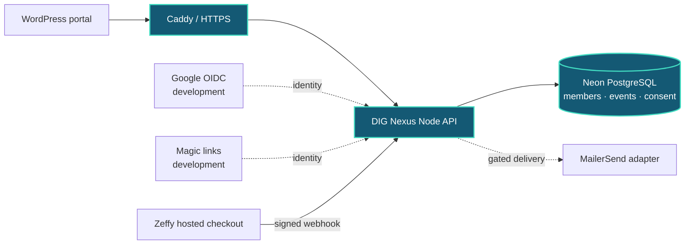

# DIG Nexus

**Neon-powered membership, events, and governance for Deaf in Government.**

DIG Nexus is an open-source platform for [Deaf in Government (DIG)](https://deafingov.org/): a single home for member profiles, conference programs, committees, governance, and communications. The selected deployment is **Docker Compose + Caddy + Neon PostgreSQL**, with WordPress as the website-facing layer. The same application image can also run on other container hosts. DIG Nexus owns its membership data and does not depend on an external CRM.

**NTC inventory boundary (development):** [Zeffy-hosted stock and Nexus verified admission](nexus/PAID-INVENTORY.md) now distinguish 24-hour non-holding payment requests from confirmed paid admission, protect the final seat under PostgreSQL concurrency, and route late, refunded or excess purchases to restricted manual review. Neither sales nor expiry jobs are enabled live.

**NTC magic links and payment recovery (development):** [Native email sign-in and verified Zeffy purchase recovery](nexus/MAGIC-PAYMENT-RECOVERY.md) allow new individual attendees to register without Google. Signed webhook mismatches enter a private manual-review queue; features stay off until staged verification.

**NTC ticketing extension (development):** [Zeffy payments, attendee QR and confidential check-in](nexus/DOCKER.md#ntc-ticketing-zeffy-and-mailersend) are implemented behind disabled-by-default flags, without a separate payment processor.

**Project status: active development — not a live membership service.** The repository contains working components, synthetic tests, database schemas, and an offline demo. It does **not** establish that Google sign-in, Neon-backed registration, newsletters, payments, or elections are available to real members. Production launch requires DIG policy approval, security and accessibility review, and a staged deployment.

**NTC conference foundation (development):** The [NTC conference specification](nexus/NTC-CONFERENCE.md) documents the independent published-only agenda API, multi-day accessible event view, and conference migration. The [organizer console deployment guide](nexus/ORGANIZER-DEPLOYMENT.md) covers staff permissions, editing, previews, and publication. The [attendee registration guide](nexus/ATTENDEE-REGISTRATION.md) documents the membership-free individual registration, atomic workshop waitlists, authenticated confirmation references and restricted accommodations workflow. Events default to draft; no real conference has been published or deployed.

**[Try the interactive offline demo](https://mcc0nnell.github.io/dig-nexus/)** · **[Visual systems atlas](https://mcc0nnell.github.io/dig-nexus/atlas.html)** · **[Mermaid system maps](docs/architecture/system-maps.md)** · **[Latest implementation status](nexus/IMPLEMENTATION-STATUS.md)** · **[Docker deployment](nexus/DOCKER.md)** · **[Security](SECURITY.md)**

## What we're building

| Area | Intended experience | Current state |
| --- | --- | --- |
| Membership | Sign in, request membership, see status, then eventually renew and manage a profile | Google OIDC/session code, explicit pending-request flow and Neon adapter; live onboarding disabled |
| Member directory | Discover opted-in colleagues across government | Schema and privacy rules; no public directory |
| Events | Register, manage capacity and check in at DIG events, including DC27 | Published-only agenda, separate NTC magic sign-in, atomic waitlists, Zeffy verified-paid admission, QR check-in; live transactions disabled |
| Committees | Organize rosters, roles, and restricted documents | Models and staff-only constituent association view; not a public deployed service |
| Governance | Maintain terms, roles, election records, and eligible-voter snapshots | Schema and eligibility rules; **no ballot casting or counting** |
| Communications | Manage explicit subscriptions, campaigns, and delivery outcomes | Consented lists, staff audience previews, approval/queue, hashed one-click unsubscribe and guarded delivery claim; **sending disabled** |
| Dues | Record externally confirmed membership payments and terms | Membership dues model only; NTC uses a **separate, disabled Zeffy** paid-admission integration |

**Association operations:** staff-restricted organizations, affiliations, case follow-ups and the accessible `/association` workspace now exist as original DIG Nexus development code. Both the constituent and campaign API flags remain disabled in the default Docker configuration.

These are development milestones, not a claim that DIG has replaced its existing systems.

## The platform architecture



- **WordPress** is the website-facing integration. The `[dig_nexus_portal]` shortcode is a development candidate. It directs members to the Nexus service; no database credentials or authorization logic belong in WordPress.
- **Docker Compose + Caddy** hosts the Node API and Google OpenID Connect authorization-code flow with PKCE. Caddy terminates HTTPS and authenticates private proxy headers. Neon stores hashed, expiring OAuth/session state. Real provider and browser deployment tests are still required.
- **Neon/PostgreSQL** is the source-of-truth architecture for the Nexus domain. The `dig-nexus-dev` development project exists; versioned SQL and isolated PostgreSQL CI do **not** imply every migration has been applied to Neon or production.
- **MailerSend** has consent-filtered queuing, a default-off one-click unsubscribe route, and a single-delivery claim/preflight adapter. This is **not** an enabled mailing operation: real plan support, signed provider events, sending-domain verification and delivery controls are still release gates.
- **Constituent management** is original DIG Nexus schema and server-authorized API code, inspired by nonprofit/association practices. CiviCRM, listmonk and Twenty are **not** deployed dependencies. Zeffy ticket receipts are separate from DIG membership dues.

**The architecture is Docker + Neon-first.** No parallel CRM or legacy membership gateway is part of the DIG Nexus runtime. See [Historical artifacts](#historical-artifacts) for obsolete code still tracked in this repository.

## Repository map

| Path | What lives there |
| --- | --- |
| [`nexus/`](nexus/) | PostgreSQL schemas, domain policies, event lifecycle, authentication, member API, and WordPress Nexus shell |
| [`newsletter/`](newsletter/) | Subscriber/campaign schemas, delivery adapter, unsubscribe tokens, and rollout rules |
| [`demo/`](demo/) | Offline, synthetic member experience published to GitHub Pages |
| [`nexus/wordpress/`](nexus/wordpress/) | DIG Nexus WordPress portal integration |
| [`nexus/NTC-CONFERENCE.md`](nexus/NTC-CONFERENCE.md) | NTC conference design and publish-only agenda release gate |
| [`nexus/docker/`](nexus/docker/) | Docker startup, secret-file loading and authenticated proxy tests |
| [`compose.yaml`](compose.yaml) and [`nexus/DOCKER.md`](nexus/DOCKER.md) | Self-hosted Caddy + Nexus stack, release and rollback runbook |
| [`nexus/cloud-run/`](nexus/cloud-run/) | Portable Node HTTP adapter and Neon-backed state, inherited from the Cloud Run prototype |
| [`nexus/ASSOCIATION-OPERATIONS.md`](nexus/ASSOCIATION-OPERATIONS.md) | Clean-room constituents, staff workspace and consent-scoped newsletter operations |
| [`nexus/IMPLEMENTATION-STATUS.md`](nexus/IMPLEMENTATION-STATUS.md) | Updated source-backed status, migration order and launch blockers |
| [`docs/architecture/experience-demo.md`](docs/architecture/experience-demo.md) | Four offline demo walkthroughs and browser-test contract |
| [`docs/architecture/system-maps.md`](docs/architecture/system-maps.md) | Mermaid maps of runtime, membership, NTC paid admission, staff constituents, and newsletter consent |
| [`demo/atlas.html`](demo/atlas.html) | Separate online Mermaid/ECharts systems atlas; original four-journey demo stays offline |
| [`nexus/PAID-INVENTORY.md`](nexus/PAID-INVENTORY.md) | NTC non-holding paid intent, verified admission and inventory boundary |
| [`nexus/jobs/`](nexus/jobs/) | Original PostgreSQL job leases and fail-closed optional cleanup worker |
| [`release/`](release/) | Independent OCI digest, source-label and signed-publisher verification |
| [`nexus/CLEANROOM-OPERATIONS.md`](nexus/CLEANROOM-OPERATIONS.md) | Clean-room design, browser tests, queue and NTC operations gates |
| [`experiments/dig-nexus/`](experiments/dig-nexus/) | Read-only-by-default Twenty/Neon integration spike |
| [`nexus/RUNTIME-INTEGRATION.md`](nexus/RUNTIME-INTEGRATION.md) | Shared API and authentication implementation details (historical Worker prerequisites noted) |

### Authentication and registration are different gates

The implemented development Google sign-in flow is `/auth/google/start` → Google → `/auth/google/callback` → session cookie → `/portal` and read-only `/api/me`. Sign-in alone does **not** create, approve, renew, or activate a membership. A new, explicit `POST /api/enroll` can create a **pending** request from the verified Google browser session, but its `MEMBER_ENROLLMENT_ENABLED` flag is off by default. The browser route enforces same-origin checks, a custom action header and rate limiting.

`POST /api/register` is separately protected and **disabled by default**. It currently expects a verified bearer identity plus origin/rate-limit controls; it does **not** accept the Google browser session cookie as registration authorization. The browser request route is distinct and does not change the bearer endpoint or silently subscribe anyone to email. Neither endpoint is enabled in production.

Read [Docker deployment](nexus/DOCKER.md), [Google OIDC](nexus/GOOGLE-OIDC.md), and [registration deployment gates](nexus/REGISTRATION-DEPLOYMENT.md) before wiring up real credentials or member data.

## Try the project

### View the demo

Visit **[mcc0nnell.github.io/dig-nexus](https://mcc0nnell.github.io/dig-nexus/)** or open [`demo/offline.html`](demo/offline.html) locally. The public demo has four interactive walkthroughs—**member journey, DC27 paid-admission/check-in, constituent follow-ups, and consent-first newsletter approval**—and is a **self-contained simulation**: no login, persistence, emails, API requests, real member records, real tickets, or money moves. It must never be used as a production enrollment link.

### Run local checks

Use **Node.js 22+** and npm. These commands validate isolated code paths and mock integrations; they do not deploy infrastructure or send email.

```bash
git clone https://github.com/mcc0nnell/dig-nexus.git
cd dig-nexus
npm ci

# Nexus and newsletter unit tests
node --test nexus/*.test.mjs \
  nexus/api/worker.test.mjs \
  nexus/api/registration.test.mjs \
  nexus/api/registration-http.test.mjs \
  nexus/api/registration-db.test.mjs \
  nexus/api/oidc.test.mjs \
  nexus/api/database.test.mjs \
  nexus/api/member-http.test.mjs \
  nexus/api/google-auth.test.mjs \
  newsletter/*.test.mjs

# Offline demo: static contract + real Chromium interactions and axe rules
node --test demo/offline.test.cjs
npx playwright install chromium
npx playwright test -c demo/playwright.config.mjs

# Portable Node runtime and Docker packaging (no public deployment)
node --test nexus/cloud-run/*.test.mjs nexus/docker/*.test.mjs
docker build -t dig-nexus:local .
```

Additional checks run in GitHub Actions: Deno compatibility, PostgreSQL 17 schemas through Nexus migration 013 and newsletter migration 004 (including synthetic concurrency), a Chromium/axe API accessibility suite, and Docker release-signing checks. The Pages workflow independently validates its offline JavaScript and browser walkthroughs before publishing. Older CI jobs still verify historical code but are not Nexus deployment gates.

**Do not run schema files against a production database to “try it out.”** Follow the ordered migrations and disposable-branch guidance in [registration deployment](nexus/REGISTRATION-DEPLOYMENT.md).

## Privacy, accessibility, and trust boundaries

DIG Nexus is for a Deaf-led organization. Accessibility and personal-data protection are requirements, not later enhancements:

- **Accessible by design:** keyboard and screen-reader operation, clear language, and ASL/captioned content need review with real users before launch.
- **Explicit consent:** being a member does not subscribe someone to a newsletter. Directory participation is opt-in and private by default.
- **Least privilege:** enforce identity, roles, and record access on the server. Never trust a browser-supplied member ID, role, or consent flag.
- **Sensitive information stays restricted:** accessibility/accommodation requests belong with authorized event staff, not public directories or marketing lists.
- **Financial and voting boundaries:** do not store card details; verify payment-provider receipts. Voter eligibility is **not** a secure secret-ballot system.
- **No production secrets or personal data in Git:** use scoped runtime secrets and synthetic test identities. See [SECURITY.md](SECURITY.md).

## Historical artifacts

Earlier experiments still appear under `wordpress/dig-membership/`, `cf/membership-site/`, `dig-src/`, and `manifest/`. Those components are **retired from the DIG Nexus design**. They are not a supported alternative backend, should not be wired into the new portal, and will be handled separately from active Nexus features. Their presence in the checkout is not an instruction to deploy them.

## Next milestones

1. **Finish live validation of the staged member journey:** deploy to a private Docker Compose + Caddy staging service and isolated Neon branch, complete real Google OAuth and Neon session-state tests, verify grants, and exercise `/api/me` end to end.
2. **Decide the registration contract:** document the verified-identity trust boundary, complete atomic/idempotent registration tests, and retain the default-off gate until reviewed.
3. **Ship a usable accessible member experience:** test the WordPress flow on real browsers with Deaf members and assistive-technology users; establish privacy, incident response, and retention procedures.
4. **Enable integrations one at a time:** review real MailerSend one-click/sending plan, consent/suppression and verified delivery; reconcile Zeffy paid inventory and refund review; then separate staff/constituent grants.
5. **Treat elections separately:** commission and review an appropriate ballot system before any binding vote.

For current verified scope and known limitations, use [implementation status](nexus/IMPLEMENTATION-STATUS.md) and the [selected Docker runbook](nexus/DOCKER.md). Earlier Worker/Cloud Run notes remain historical or optional alternatives, not deployment instructions for the selected stack.

## Contributing

Issues and small, testable pull requests are welcome. Prefer changes with a documented user need, explicit security and privacy boundaries, and synthetic tests. Never include member records, credentials, or production logs in an issue or pull request.

Licensed under [Apache 2.0](LICENSE). DIG Nexus is a development project; this repository does not authorize changes to DIG production infrastructure or policy.
