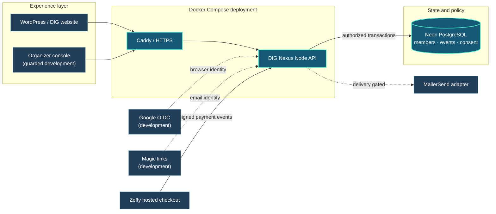
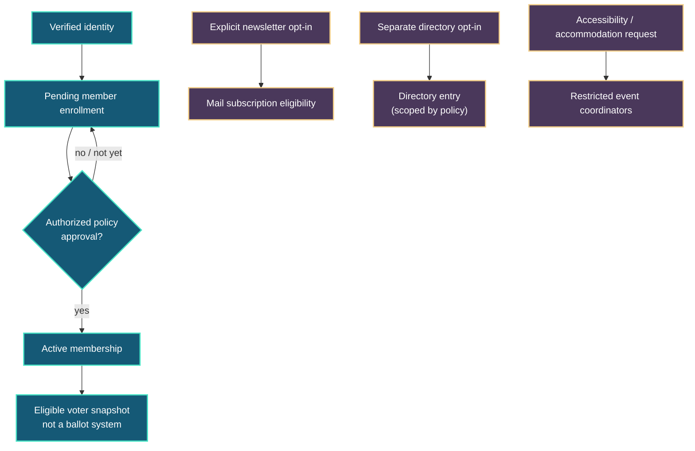
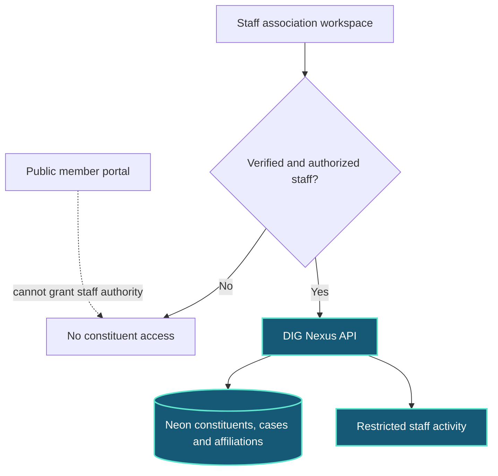
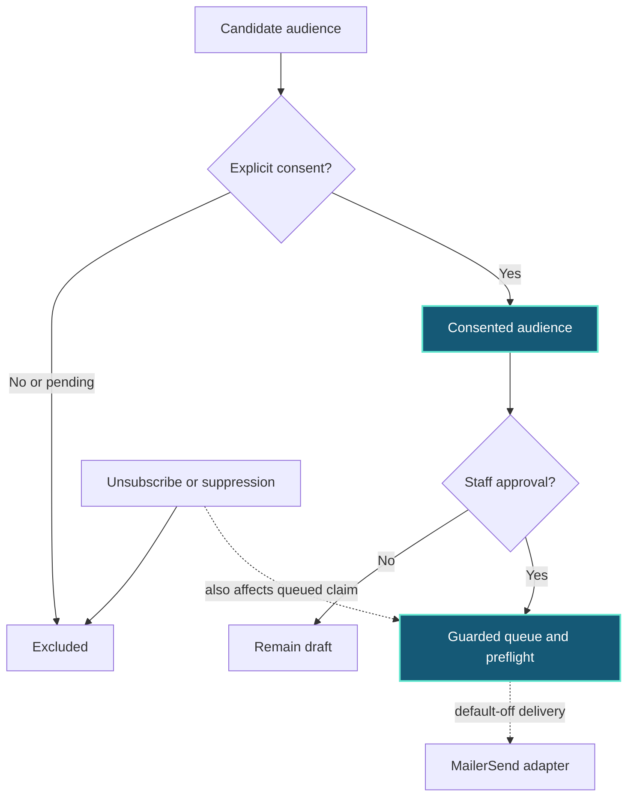

# DIG Nexus — system maps

Editable Mermaid sources for the [systems atlas](../../demo/atlas.html) and the [offline member demo](../../demo/offline.html). GitHub renders these diagrams directly in Markdown. Each diagram is a **design and development map**, not evidence that a feature is live.

> Runtime target: **Docker Compose + Caddy + Node API + Neon PostgreSQL**. WordPress is an experience layer, not a privileged gateway or system of record. No Salesforce or Twenty dependency is required.

## 1. Container runtime and integration edges



**Reading guide:** Solid lines show architectural dependencies or trust boundaries; dashed lines indicate gated integration paths, *not production availability*. Signed webhook authentication does not itself establish a seat, payment reconciliation or admission.

## 2. Identity, enrollment, consent and governance



**No automatic edges:** sign-in does not approve membership, subscribe someone to communications, publish them in a directory, or authorize a binding vote. Real ballot casting/counting does not exist in Nexus.

## 3. Conference ticket and payment reconciliation

```mermaid
sequenceDiagram
  autonumber
  actor Attendee
  participant Nexus as DIG Nexus API
  participant Neon as Neon PostgreSQL
  participant Zeffy as Zeffy hosted checkout
  participant Staff as Authorized organizer
  Note over Attendee,Staff: Conceptual staging contract; live sales and expiry jobs disabled
  Attendee->>Nexus: Register independently of membership
  Nexus->>Neon: Create expiring non-holding payment request
  Nexus-->>Attendee: Hosted payment instructions
  Attendee->>Zeffy: Complete payment outside Nexus
  Zeffy-->>Nexus: Signed payment notification
  Nexus->>Neon: Reconcile receipt; idempotent seat claim
  alt verified purchase and seat available
    Neon-->>Nexus: Confirm paid admission
    Nexus-->>Attendee: Verified confirmation / scoped QR
  else late, mismatch, refund or capacity conflict
    Neon-->>Nexus: Restricted manual review
    Nexus-->>Staff: Review outcome without leaking sensitive data
  end
```

**Important:** A Zeffy checkout success screen does not grant admission. Nexus must independently validate provider evidence and atomic inventory allocation; otherwise staff review is required. No card details or accommodation details belong in QR payloads.

## 4. Staff constituent access boundary



The association staff workspace and case APIs exist as guarded development code, not a public case-management service. The offline demo's Jordan Example profile is fictional. Server-authorized access and explicit staff grants remain launch gates.

## 5. Newsletter consent and suppression



The offline newsletter walkthrough illustrates **one opted-in identity and one pending identity**; neither is a real subscriber. Pending consent cannot receive a message, and queued delivery does not mean email has been sent. Actual sending stays disabled until its release gates are satisfied.

## 6. What the visualization is and is not

- [Systems atlas](../../demo/atlas.html) combines Mermaid rendering with three ECharts charts. It loads pinned third-party visualization code from a CDN and requires connectivity; chart values are invented fixtures.
- [Offline demo](../../demo/offline.html) remains a single file with **no external scripts, network requests, storage, or real member data**.
- Browser charts have explicit table equivalents and textual diagram sources. Keyboard navigation, screen readers, reduced-motion preference and mobile layouts still require manual accessibility review.
- This document describes current intended boundaries, not deployment proof. Consult the [implementation status](../../nexus/IMPLEMENTATION-STATUS.md), [paid inventory](../../nexus/PAID-INVENTORY.md), and [Docker runbook](../../nexus/DOCKER.md) for feature gates and validation procedures.
